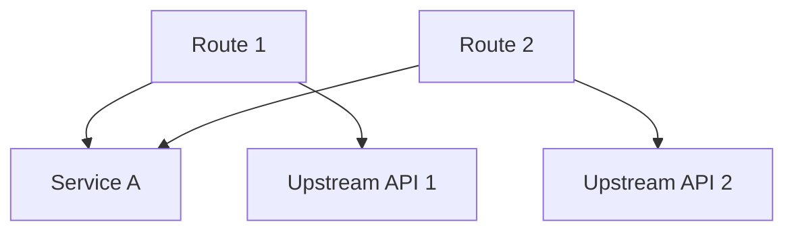
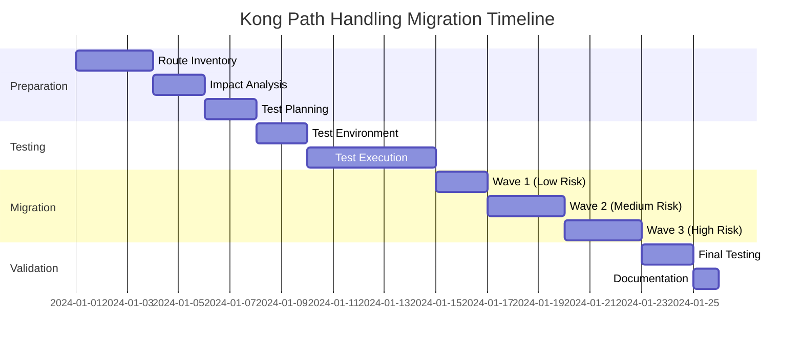

# Kong API Gateway Path Handling Migration Template
## v1 → v0 Migration Project

---

## 📋 Project Overview

### Project Information
- **Project Name:** Kong Path Handling Migration (v1 → v0)
- **Start Date:** [ ]
- **Target Completion Date:** [ ]
- **Project Owner:** [ ]
- **Technical Lead:** [ ]

### Executive Summary
> Brief description of why this migration is necessary and expected outcomes

### Business Objectives
- [ ] Standardize path handling across all routes
- [ ] Improve API consistency
- [ ] Reduce configuration complexity
- [ ] [ Add more objectives ]

---

## 🔍 Technical Analysis

### Path Handling Comparison

#### v0 (Strip Path) Behavior
```
Service Path: /api
Route Path: /v1/users
Request: /v1/users/123

Upstream Request: /api/123
```
- **特点：** Route path 会被剥离，只保留剩余部分
- **适用场景：** [ ]

#### v1 (Preserve Path) Behavior
```
Service Path: /api
Route Path: /v1/users
Request: /v1/users/123

Upstream Request: /api/v1/users/123
```
- **特点：** 完整保留请求路径
- **适用场景：** [ ]

### Current State Analysis
| Metric | Value | Notes |
|--------|-------|-------|
| Total Routes | [ ] | |
| Routes with v1 | [ ] | |
| Routes with v0 | [ ] | |
| Routes without explicit setting | [ ] | |
| Services affected | [ ] | |

---

## 📊 Impact Assessment

### Risk Analysis

#### High Risk Routes
| Route Name | Service | Current Path Handling | Impact Level | Mitigation Strategy |
|------------|---------|---------------------|--------------|-------------------|
| [ ] | [ ] | v1 | High | [ ] |

#### Medium Risk Routes
| Route Name | Service | Current Path Handling | Impact Level | Mitigation Strategy |
|------------|---------|---------------------|--------------|-------------------|
| [ ] | [ ] | v1 | Medium | [ ] |

#### Low Risk Routes
| Route Name | Service | Current Path Handling | Impact Level | Mitigation Strategy |
|------------|---------|---------------------|--------------|-------------------|
| [ ] | [ ] | v1 | Low | [ ] |

### Dependency Mapping


### Client Impact Analysis
| Client/Consumer | Routes Used | Impact Description | Communication Plan |
|-----------------|-------------|-------------------|-------------------|
| [ ] | [ ] | [ ] | [ ] |

---

## 🗓️ Migration Plan

### Phase 1: Preparation ([ ] days)
- [ ] Complete route inventory
- [ ] Identify all v1 routes
- [ ] Document current behavior
- [ ] Create test cases
- [ ] Setup monitoring

### Phase 2: Testing ([ ] days)
- [ ] Create test environment
- [ ] Clone production routes
- [ ] Modify to v0 in test
- [ ] Execute test cases
- [ ] Performance testing

### Phase 3: Staged Migration ([ ] days)
#### Wave 1: Low Risk Routes
- **Date:** [ ]
- **Routes:** [ ]
- [ ] Pre-migration validation
- [ ] Execute migration
- [ ] Post-migration validation
- [ ] Monitor for 24 hours

#### Wave 2: Medium Risk Routes
- **Date:** [ ]
- **Routes:** [ ]
- [ ] Pre-migration validation
- [ ] Execute migration
- [ ] Post-migration validation
- [ ] Monitor for 48 hours

#### Wave 3: High Risk Routes
- **Date:** [ ]
- **Routes:** [ ]
- [ ] Pre-migration validation
- [ ] Execute migration
- [ ] Post-migration validation
- [ ] Monitor for 72 hours

### Phase 4: Validation & Cleanup ([ ] days)
- [ ] Full system validation
- [ ] Performance benchmarking
- [ ] Documentation update
- [ ] Remove old configurations

---

## 🔄 Rollback Strategy

### Rollback Triggers
- [ ] Error rate > [ ]%
- [ ] Response time > [ ]ms
- [ ] Failed health checks
- [ ] Client complaints > [ ]

### Rollback Procedure
1. **Immediate Actions**
   - [ ] Alert incident team
   - [ ] Execute rollback script
   - [ ] Verify rollback success

2. **Communication**
   - [ ] Notify stakeholders
   - [ ] Update status page
   - [ ] Document incident

3. **Post-Rollback**
   - [ ] Root cause analysis
   - [ ] Update migration plan
   - [ ] Schedule retry

---

## 📝 Route Inventory

### Tracking Table
| ID | Route Name | Service | Current Path | Target Path | Path Handling | Status | Migration Date | Notes |
|----|------------|---------|--------------|-------------|---------------|--------|----------------|-------|
| 1 | [ ] | [ ] | [ ] | [ ] | v1→v0 | 🔴 Not Started | [ ] | [ ] |
| 2 | [ ] | [ ] | [ ] | [ ] | v1→v0 | 🟡 In Progress | [ ] | [ ] |
| 3 | [ ] | [ ] | [ ] | [ ] | v1→v0 | 🟢 Completed | [ ] | [ ] |

### Status Legend
- 🔴 **Not Started** - Route identified but not migrated
- 🟡 **In Progress** - Migration ongoing
- 🟢 **Completed** - Successfully migrated
- 🔵 **Validated** - Post-migration validation passed
- ⚫ **Skipped** - Route excluded from migration

---

## ✅ Testing Checklist

### Pre-Migration Tests
#### Route Configuration
- [ ] Current path handling documented
- [ ] Upstream service compatibility verified
- [ ] Request/response format documented
- [ ] Authentication method verified

#### Functional Tests
- [ ] GET requests
- [ ] POST requests with body
- [ ] PUT/PATCH requests
- [ ] DELETE requests
- [ ] Query parameters handling
- [ ] Path parameters handling
- [ ] Headers forwarding

### Post-Migration Tests
- [ ] All pre-migration tests pass
- [ ] Response time within SLA
- [ ] Error rate < threshold
- [ ] Correct path forwarding to upstream
- [ ] No breaking changes for clients

---

## 📊 Monitoring & Metrics

### Key Metrics to Track
| Metric | Pre-Migration | Post-Migration | Target | Status |
|--------|---------------|----------------|--------|--------|
| Error Rate | [ ]% | [ ]% | <[ ]% | [ ] |
| P95 Latency | [ ]ms | [ ]ms | <[ ]ms | [ ] |
| P99 Latency | [ ]ms | [ ]ms | <[ ]ms | [ ] |
| Success Rate | [ ]% | [ ]% | >[ ]% | [ ] |

### Monitoring Dashboard Links
- **Kong Admin API:** [ ]
- **Prometheus:** [ ]
- **Grafana:** [ ]
- **Application Logs:** [ ]

---

## 🚨 Issue Tracking

### Known Issues
| Issue ID | Description | Severity | Status | Resolution |
|----------|-------------|----------|--------|------------|
| [ ] | [ ] | High/Medium/Low | Open/Closed | [ ] |

### Blockers
- [ ] Issue description and impact
- [ ] Mitigation plan

---

## 📄 Documentation

### Configuration Templates

#### Before Migration (v1)
```yaml
routes:
  - name: example-route-v1
    paths:
      - /v1/users
    path_handling: v1
    service: example-service
```

#### After Migration (v0)
```yaml
routes:
  - name: example-route-v0
    paths:
      - /v1/users
    path_handling: v0
    service: example-service
```

### Migration Scripts
```bash
# Example migration script placeholder
#!/bin/bash
# TODO: Add actual migration commands
```

### API Documentation Updates
- [ ] Update API documentation
- [ ] Update integration guides
- [ ] Update client SDKs
- [ ] Update postman collections

---

## 📢 Communication Plan

### Stakeholder Communication
| Stakeholder Group | Communication Method | Frequency | Responsible |
|-------------------|---------------------|-----------|-------------|
| Engineering Team | Slack + Email | Daily | [ ] |
| Product Team | Email | Weekly | [ ] |
| Clients | Email + Portal | Per Phase | [ ] |
| Management | Report | Weekly | [ ] |

### Communication Templates

#### Pre-Migration Notice
```
Subject: Upcoming Kong API Gateway Route Migration

Dear [Client],

We will be migrating our API routes to improve consistency...
[Customize template]
```

#### Post-Migration Confirmation
```
Subject: Kong API Gateway Route Migration Completed

Dear [Client],

We have successfully completed the migration...
[Customize template]
```

---

## 🎯 Success Criteria

### Technical Success
- [ ] All routes migrated to v0
- [ ] Zero downtime during migration
- [ ] No increase in error rates
- [ ] Performance maintained or improved

### Business Success
- [ ] No customer complaints
- [ ] Improved system maintainability
- [ ] Reduced configuration complexity
- [ ] Team trained on new standard

---

## 📅 Timeline & Milestones



---

## 🔧 Tools & Resources

### Useful Commands
```bash
# List all routes with path_handling
curl -X GET http://localhost:8001/routes | jq '.data[] | {name: .name, path_handling: .path_handling}'

# Update route path_handling
curl -X PATCH http://localhost:8001/routes/{route_id} \
  --data "path_handling=v0"

# Backup route configuration
curl -X GET http://localhost:8001/routes/{route_id} > route_backup.json
```

### References
- [Kong Path Handling Documentation](https://docs.konghq.com/gateway/latest/reference/proxy/#path-handling)
- [Kong Admin API Reference](https://docs.konghq.com/gateway/latest/admin-api/)
- [Internal Migration Guidelines]()

---

## 📋 Appendix

### Glossary
- **Path Handling:** Controls how Service path, Route path, and requested path are combined
- **v0 (Strip Path):** Removes the Route path from the request before forwarding
- **v1 (Preserve Path):** Keeps the full request path when forwarding

### Change Log
| Date | Version | Changes | Author |
|------|---------|---------|---------|
| [ ] | 1.0 | Initial template | [ ] |

---

## ✍️ Sign-off

### Approval Matrix
| Role | Name | Signature | Date |
|------|------|-----------|------|
| Project Owner | [ ] | [ ] | [ ] |
| Technical Lead | [ ] | [ ] | [ ] |
| QA Lead | [ ] | [ ] | [ ] |
| Operations Lead | [ ] | [ ] | [ ] |

---

**Template Version:** 1.0  
**Last Updated:** [Current Date]  
**Next Review:** [Review Date]